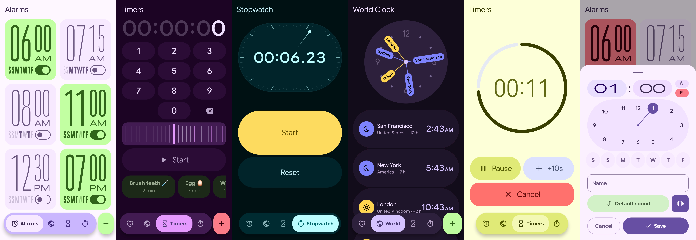

# Clock
*A Material 3 Expressive clock app*

App #2 in the suite. A real Compose app, not a mockup: it builds, installs and runs.

It is a recreation of the M3 Expressive research-concept clock, meaning the unshipped one from
Google's 46-study programme rather than Google Clock 8.8. Source renders and the measurements taken
off them are in `../clock-mockups/reference/concept/`.

Four tabs: Alarms · World Clock · Timers · Stopwatch. The concept has three (Alarms, Map, Settings)
and no stopwatch, so two of these are extrapolated.

## Features

**Alarms**
- Repeating or one-shot alarms with day toggles, labels, vibration and snooze.
- Time picker with haptic ticks on the hour and minute hand.
- In-app "Alarm sound" picker like Google Clock's: device sounds, Silent, Default, and your own
  files via "Add new", with tap-to-preview.
- Reliable exact-alarm ringing with a full-screen dismiss screen, plus Snooze and Dismiss on the
  notification.

**Timers**
- Keypad entry with rounded readout digits, saved presets, and +10 s / +1 min.
- Google-style running timer: progress ring that steps smoothly, large digits that thin when
  paused, and a red Cancel button.
- Own timer sound and vibration settings.

**Stopwatch**
- Oval dial with a tapered hand, touch glow and slide morph, bounce and pop animations.
- Start / Stop / Lap / Reset buttons laid out for every state, no scrolling required.
- Horizontal lap cards: fastest in tertiary, slowest in red.

**World clock**
- Cities with analog dials; hands and tags are yellow by day and blue by night.
- Rounded digital times with small AM/PM.

**Live activities and notifications**
- Timer and stopwatch notifications tick on their own, stay live while paused, and have action
  buttons (pause, +1 min, lap, reset and so on).
- Ringing alarms and finished timers opt into Android 16 Live Updates and keep their actions for
  Dynamic-Island-style apps.

**Look and feel**
- Material 3 Expressive with dynamic colour and several themes, Google Sans Flex variable font,
  and haptics on toggles, navigation, pickers and stopwatch/timer buttons.

**Releases**
- Betas (`beta-N`) and stable (`vX.Y.Z`) share one app id and signing key, so you can move between
  them without uninstalling.

## Licence

This project's own code is MIT. See [`LICENSE`](LICENSE).

It bundles two font binaries which are not MIT: Google Sans Flex and a ten-glyph subset of Noto Sans
Arabic, both under the SIL Open Font License 1.1. Their copyright notices, what was modified and
why, and the full licence text are in [`THIRD-PARTY-NOTICES.md`](THIRD-PARTY-NOTICES.md) and
[`licenses/OFL-1.1.txt`](licenses/OFL-1.1.txt).

Google, Google Sans, Material, Android and Pixel are trademarks of Google LLC. This project is not
affiliated with, sponsored by or endorsed by Google. It is an independent recreation of a published
Material 3 Expressive concept design. The concept renders it was measured against are Google's
copyright and are not included here.
